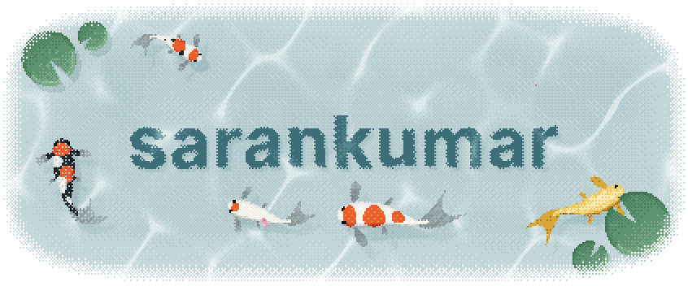
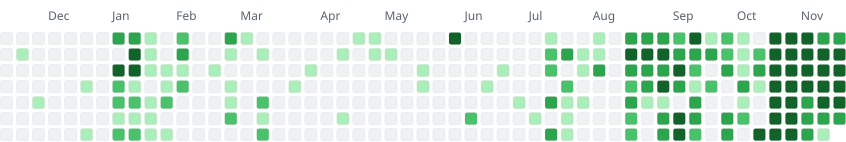

<!-- Written by scripts/build.mjs from data/activity.json; the pond is drawn by scripts/pond.mjs. -->

<picture>
  <source media="(prefers-color-scheme: dark)" srcset="assets/pond-dark.gif">
  <source media="(prefers-color-scheme: light)" srcset="assets/pond-light.gif">
  
</picture>

<b>2,883</b>&nbsp;contributions&nbsp;in&nbsp;the&nbsp;last&nbsp;year&nbsp;&nbsp;·&nbsp; <b>1,285</b>&nbsp;commits&nbsp;&nbsp;·&nbsp; <b>623</b>&nbsp;pull&nbsp;requests&nbsp;merged&nbsp;&nbsp;·&nbsp; <b>35</b>&nbsp;days&nbsp;in&nbsp;a&nbsp;row

<picture>
  <source media="(prefers-color-scheme: dark)" srcset="assets/calendar-cdf92871-dark.svg">
  <source media="(prefers-color-scheme: light)" srcset="assets/calendar-cdf92871-light.svg">
  
</picture>

Counting <a href="https://github.com/sarankumar1325">@sarankumar1325</a> and <a href="https://github.com/swsarancodes">@swsarancodes</a>&nbsp;&nbsp;·&nbsp; last push to <a href="https://github.com/sarankumar1325/alertmanager">alertmanager</a> on 20 November, 15:26 IST

### Recently merged

&ensp;<b>Fix Gateway API conformance report and CRS ruleset links</b> 
<a href="https://github.com/traefik/traefik/pull/14253">traefik/traefik#14253</a>&nbsp;&nbsp;·&nbsp; merged&nbsp;12&nbsp;Nov&nbsp;&nbsp;·&nbsp; ★&nbsp;65.6k

&ensp;<b>Keep an image caption with its picture</b> 
<a href="https://github.com/docling-project/docling/pull/5037">docling-project/docling#5037</a>&nbsp;&nbsp;·&nbsp; merged&nbsp;6&nbsp;Nov&nbsp;&nbsp;·&nbsp; ★&nbsp;70.8k

&ensp;<b>Match GitHub remotes with ports and git:// URLs again</b> 
<a href="https://github.com/nektos/act/pull/6234">nektos/act#6234</a>&nbsp;&nbsp;·&nbsp; merged&nbsp;31&nbsp;Oct&nbsp;&nbsp;·&nbsp; ★&nbsp;72.8k

&ensp;<b>Remove git remote when deleting a push mirror</b> 
<a href="https://github.com/go-gitea/gitea/pull/40049">go-gitea/gitea#40049</a>&nbsp;&nbsp;·&nbsp; merged&nbsp;31&nbsp;Oct&nbsp;&nbsp;·&nbsp; ★&nbsp;59.2k

&ensp;<b>Fix dead links to moved llm-d, Dynamo, TPU, Ray and Tensorizer pages</b> 
<a href="https://github.com/vllm-project/vllm/pull/64666">vllm-project/vllm#64666</a>&nbsp;&nbsp;·&nbsp; merged&nbsp;30&nbsp;Oct&nbsp;&nbsp;·&nbsp; ★&nbsp;97.3k

&ensp;<b>MUL-8277 fix(issues): load every Gantt page when the server caps page size</b> 
<a href="https://github.com/multica-ai/multica/pull/9573">multica-ai/multica#9573</a>&nbsp;&nbsp;·&nbsp; merged&nbsp;27&nbsp;Oct&nbsp;&nbsp;·&nbsp; ★&nbsp;56.9k

<a href="https://github.com/search?q=author%3Asarankumar1325%20author%3Aswsarancodes%20is%3Apr%20is%3Amerged&amp;type=pullrequests">All merged pull requests</a>

### Commits in the last 30 days

&ensp;<b>120</b>&ensp;<a href="https://github.com/sarankumar1325/url-shortner">url-shortner</a> 
&ensp;<b>85</b>&ensp;<a href="https://github.com/swsarancodes/goforge">goforge</a> 
&ensp;<b>31</b>&ensp;<a href="https://github.com/wheelgap/tracker">wheelgap/tracker</a> 
&ensp;<b>29</b>&ensp;<a href="https://github.com/wheelgap/wheelgap">wheelgap/wheelgap</a> 
&ensp;<b>26</b>&ensp;<a href="https://github.com/DiffCI/core">DiffCI/core</a>

