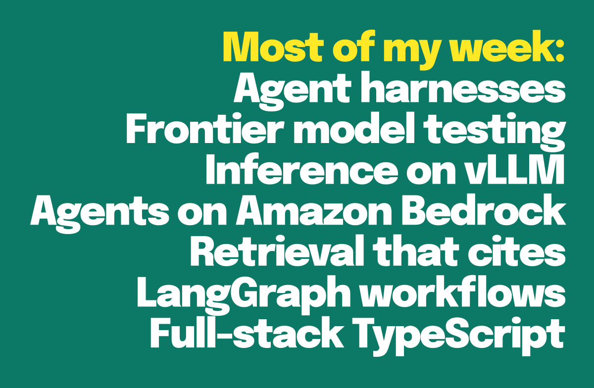
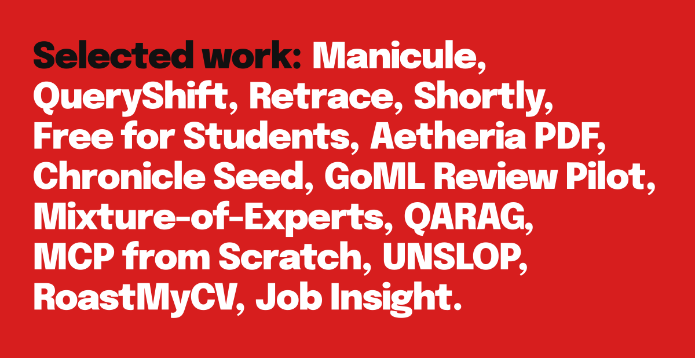
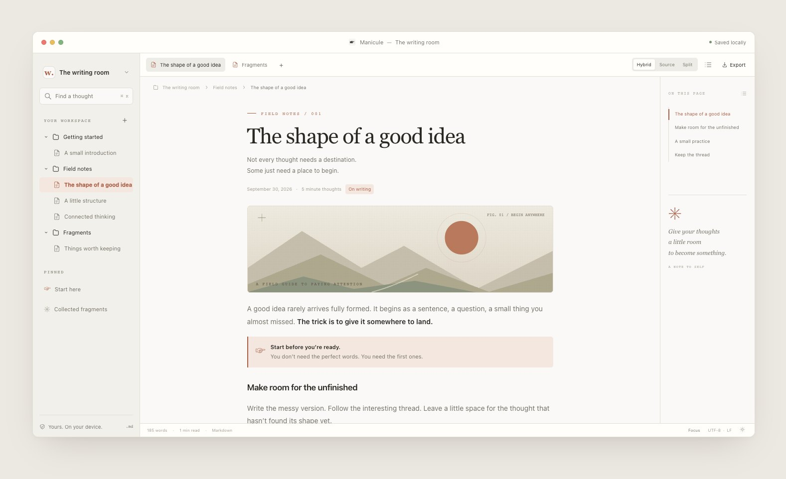
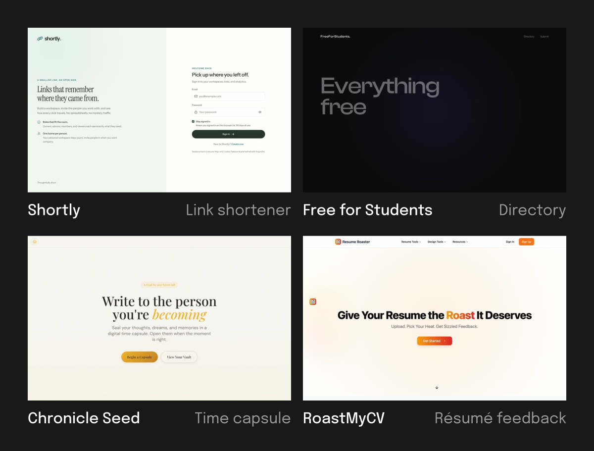
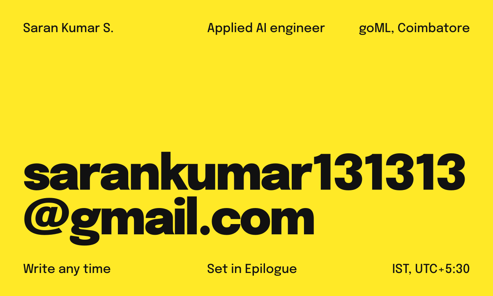

[sarankumar.space](https://www.sarankumar.space) · [Writing](https://www.sarankumar.space/blogs) · [Résumé](https://www.sarankumar.space/resume) · [LinkedIn](https://www.linkedin.com/in/saran-kumar-s-sk13022005) · [X](https://x.com/iamsaranhere) · [Kaggle](https://www.kaggle.com/sarankumar132513) · [LeetCode](https://leetcode.com/u/sarankumar131313/) · [Email](mailto:sarankumar131313@gmail.com)

I'm Saran, 21, an applied AI engineer at [goML](https://www.goml.io) in Coimbatore, India. I started there as an ML engineering intern in June 2025 and moved into applied AI a year later. My days go into agent harnesses, inference on vLLM and Amazon Bedrock, and putting each new frontier model through the kind of work our clients actually do. In the evenings I build tools I want to use, and I write, mostly about models and sometimes about streetlamps.

**Daily** Python, TypeScript, PyTorch, LangGraph, vLLM, Amazon Bedrock, FastAPI, React, PostgreSQL 
**Also** Go, Next.js, Node.js, Docker, Terraform, Google Cloud, Redis, Supabase, MongoDB, Neo4j, TensorFlow, scikit‑learn, Flutter

**[Manicule](https://manicule.online)** is a quiet Markdown studio. You edit visually, with live decorations, while your plain `.md` file stays the byte-faithful source of truth. Local first, no account. [Source](https://github.com/swsarancodes/Manicule)

### Products

- **[Shortly](https://shortlyyy-web.vercel.app)** A URL shortener with workspaces, roles and click analytics. FastAPI, React 19, Neon Postgres, Upstash Redis. [Source](https://github.com/sarankumar1325/url-shortner)
- **[Free for Students](https://freeforunifolks.vercel.app)** A community-curated directory of free software and services for verified students. [Source](https://github.com/sarankumar1325/FREEFORSTUDENTS)
- **[Aetheria PDF](https://v0pdftools.vercel.app)** PDF tools that run entirely in your browser: merge, delete pages, encrypt with AES-256. Bun, React. [Source](https://github.com/sarankumar1325/v0pdtools)
- **[Chronicle Seed](https://chronicleseed.vercel.app)** A digital time capsule. Write to the person you're becoming and seal it until the right moment.
- **[GoML Review Pilot](https://gomlreviewpilot.vercel.app)** Model-agnostic code review. Swap Gemini 2.5, Lyzr, Kimi K2 and Devstral without changing your workflow.
- **[RoastMyCV](https://roastmycv-tau.vercel.app)** Candid resume feedback with adjustable intensity and scoring. [Source](https://github.com/sarankumar1325/ROASTMYCV)
- **[Job Insight](https://jobinsightai.vercel.app)** ATS-ready resumes and career guidance from live job descriptions. [Source](https://github.com/sarankumar1325/JOB-INSIGHT)

### Agents, models and research

- **[QueryShift](https://github.com/sarankumar1325/pgbot)** Evidence-backed PostgreSQL change intelligence in Go. A Bedrock multi-agent workflow proposes changes, and policy-enforced code stays the execution boundary. Built on [pgrundev/pgbot](https://github.com/pgrundev/pgbot).
- **[Retrace](https://github.com/swsarancodes/retrace)** Verifiable fact-level unlearning for LLMs. Fine-tune a model, erase one fact on request, then prove it with a verification suite and an audit report.
- **[Mixture-of-Experts](https://github.com/sarankumar1325/Mixture-of-Experts)** Basic, sparse and shared-expert MoE layers in PyTorch, with routing, load balancing and capacity control.
- **[QARAG](https://github.com/sarankumar1325/QARAG)** A document assistant: upload files or URLs, ask questions, get streamed answers with cited sources. FastAPI, React.
- **[MCP from Scratch](https://github.com/sarankumar1325/MCP-FROM-SCRATCH)** A Model Context Protocol server and client in TypeScript, with a Gemini-powered CLI.
- **[UNSLOP](https://github.com/swsarancodes/UNSLOP-AI)** An agent skill that stops AI from writing like an AI.

Some of my newer work lives on my second account, [@swsarancodes](https://github.com/swsarancodes).

### Writing

At goML I put each new frontier model through enterprise work and write up what holds up. This list refreshes every day from [my blog](https://www.sarankumar.space/blogs).

<!-- writing:start -->

<!-- writing:end -->

