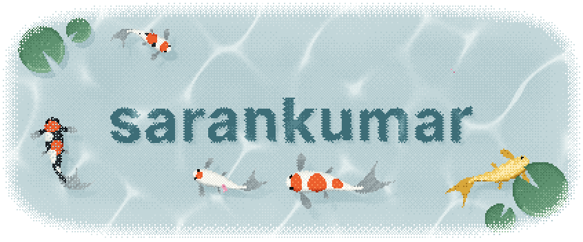

<!-- Written by scripts/build.mjs from data/activity.json; the pond is drawn by scripts/pond.mjs. -->

<picture>
  <source media="(prefers-color-scheme: dark)" srcset="assets/pond-dark.gif">
  <source media="(prefers-color-scheme: light)" srcset="assets/pond-light.gif">
  
</picture>

  <a href="https://sarankumar.space">Portfolio</a>
  &nbsp;&nbsp;·&nbsp;&nbsp;
  <a href="https://www.linkedin.com/in/saran-kumar-s-sk13022005/">LinkedIn</a>
  &nbsp;&nbsp;·&nbsp;&nbsp;
  <a href="https://x.com/iamsaranhere">X</a>

<b>2,153</b>&nbsp;contributions&nbsp;in&nbsp;the&nbsp;last&nbsp;year&nbsp;&nbsp;·&nbsp; <b>933</b>&nbsp;commits&nbsp;&nbsp;·&nbsp; <b>303</b>&nbsp;pull&nbsp;requests&nbsp;merged&nbsp;&nbsp;·&nbsp; <b>22</b>&nbsp;days&nbsp;in&nbsp;a&nbsp;row

<picture>
  <source media="(prefers-color-scheme: dark)" srcset="assets/calendar-3dfef19b-dark.svg">
  <source media="(prefers-color-scheme: light)" srcset="assets/calendar-3dfef19b-light.svg">
  
</picture>

Counting <a href="https://github.com/sarankumar1325">@sarankumar1325</a> and <a href="https://github.com/swsarancodes">@swsarancodes</a>&nbsp;&nbsp;·&nbsp; last push to <a href="https://github.com/sarankumar1325/influxdb-client-python">influxdb-client-python</a> on 6 November, 21:46 IST

### Recently merged

&ensp;<b>Keep an image caption with its picture</b> 
<a href="https://github.com/docling-project/docling/pull/5037">docling-project/docling#5037</a>&nbsp;&nbsp;·&nbsp; merged&nbsp;6&nbsp;Nov&nbsp;&nbsp;·&nbsp; ★&nbsp;70.2k

&ensp;<b>Match GitHub remotes with ports and git:// URLs again</b> 
<a href="https://github.com/nektos/act/pull/6234">nektos/act#6234</a>&nbsp;&nbsp;·&nbsp; merged&nbsp;31&nbsp;Oct&nbsp;&nbsp;·&nbsp; ★&nbsp;72.6k

&ensp;<b>Remove git remote when deleting a push mirror</b> 
<a href="https://github.com/go-gitea/gitea/pull/40049">go-gitea/gitea#40049</a>&nbsp;&nbsp;·&nbsp; merged&nbsp;31&nbsp;Oct&nbsp;&nbsp;·&nbsp; ★&nbsp;58.9k

&ensp;<b>Fix dead links to moved llm-d, Dynamo, TPU, Ray and Tensorizer pages</b> 
<a href="https://github.com/vllm-project/vllm/pull/64666">vllm-project/vllm#64666</a>&nbsp;&nbsp;·&nbsp; merged&nbsp;30&nbsp;Oct&nbsp;&nbsp;·&nbsp; ★&nbsp;96.5k

&ensp;<b>Fix typos in plugin type error and documentation</b> 
<a href="https://github.com/traefik/traefik/pull/14186">traefik/traefik#14186</a>&nbsp;&nbsp;·&nbsp; merged&nbsp;30&nbsp;Oct&nbsp;&nbsp;·&nbsp; ★&nbsp;65.5k

&ensp;<b>Keep the global Document type out of the published route discovery types</b> 
<a href="https://github.com/remix-run/react-router/pull/15680">remix-run/react-router#15680</a>&nbsp;&nbsp;·&nbsp; merged&nbsp;24&nbsp;Oct&nbsp;&nbsp;·&nbsp; ★&nbsp;56.6k

<a href="https://github.com/search?q=author%3Asarankumar1325%20author%3Aswsarancodes%20is%3Apr%20is%3Amerged&amp;type=pullrequests">All merged pull requests</a>

### Commits in the last 30 days

&ensp;<b>156</b>&ensp;<a href="https://github.com/swsarancodes/goforge">goforge</a> 
&ensp;<b>120</b>&ensp;<a href="https://github.com/sarankumar1325/url-shortner">url-shortner</a> 
&ensp;<b>47</b>&ensp;<a href="https://github.com/sarankumar1325/pgbot">pgbot</a> 
&ensp;<b>14</b>&ensp;<a href="https://github.com/prometheus-community/helm-charts">prometheus-community/helm-charts</a> 
&ensp;<b>12</b>&ensp;<a href="https://github.com/swsarancodes/Manicule">Manicule</a>

