<!-- Written by scripts/build.mjs. Edit the content there, then run `npm run build`. -->

I'm Saran, 21. At [goML](https://www.goml.io) I build agent harnesses on LangGraph and Amazon Bedrock, run inference on vLLM, and put each new frontier model through the kind of work our clients actually do. I joined as an ML engineering intern in June 2025 and became an applied AI engineer a year later. Evenings go into tools I want to use myself, and into writing, mostly about models and sometimes about streetlamps.

 
 
 
 
 
 
 
 
 
 
 

 
 
 
 
 
 

